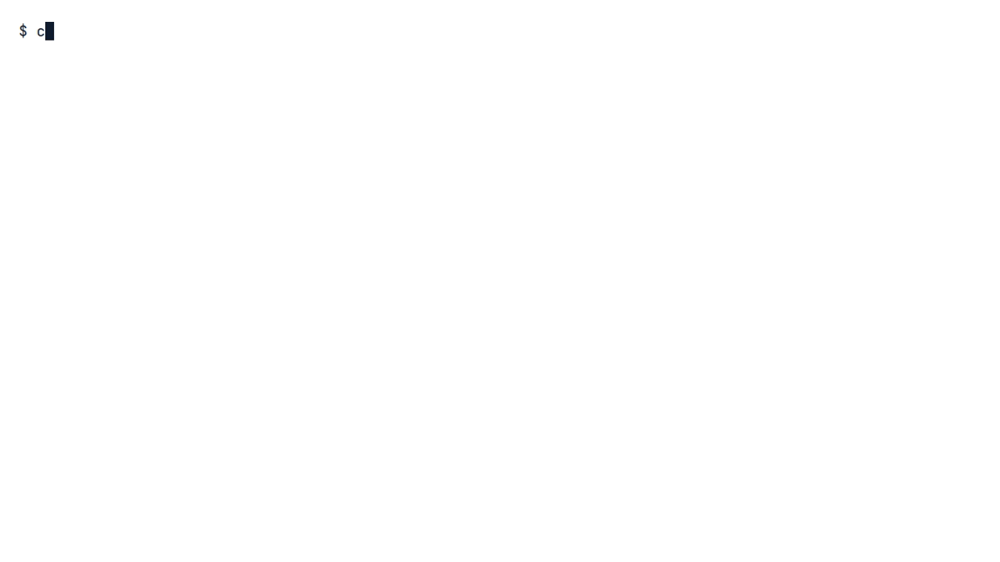
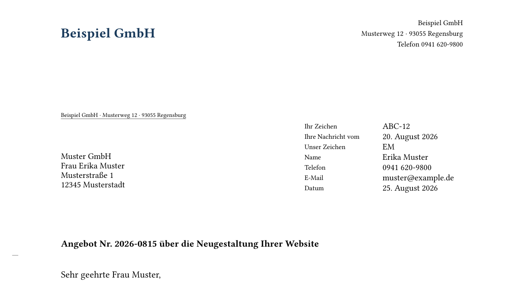
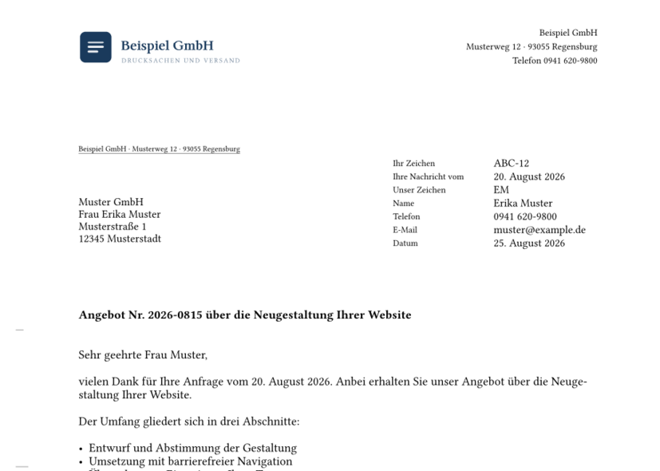
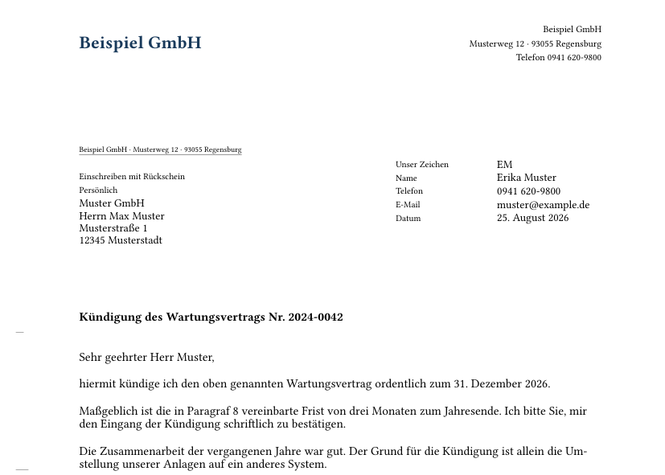
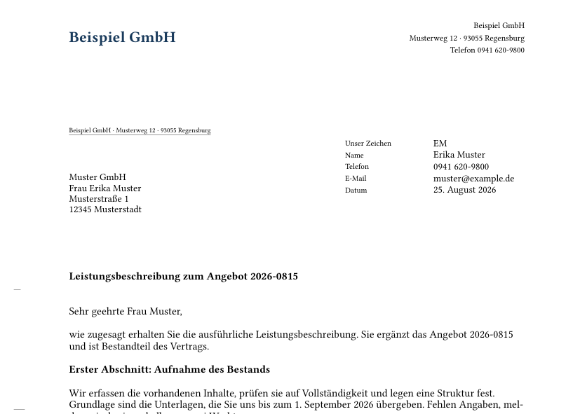

<div align="center">


[](https://github.com/blitzsicht/falzmarke/actions/workflows/ci.yml)
[](https://github.com/blitzsicht/falzmarke/releases/latest)
[](https://github.com/blitzsicht/falzmarke/blob/main/LICENSE)
[](https://github.com/blitzsicht/falzmarke/blob/main/pyproject.toml)
[](https://github.com/blitzsicht/falzmarke/blob/main/skill/references/din5008.md)

</div>

---

**Andere Werkzeuge erzeugen ein PDF. falzmarke prüft das Ergebnis.**

Du schreibst den Inhalt als Markdown. falzmarke setzt daraus einen Geschäftsbrief nach
DIN 5008:2020 als PDF/A — und misst anschließend das fertige PDF nach. Sitzt die Falzmarke nicht
auf 105,0 mm, endet der Lauf mit einem Fehler statt mit einem Brief, der nur ungefähr stimmt.

<div align="center">

**[falzmarke.com — Anleitung ohne Terminal](https://falzmarke.com/?utm_source=footer&utm_medium=product&utm_campaign=readme-202611)** ·
**[⬇ Als Claude-Skill laden](https://github.com/blitzsicht/falzmarke/releases/latest/download/falzmarke.skill)** ·
**[In 60 Sekunden ausprobieren](#in-60-sekunden)** ·
**[Beispielbrief ansehen](https://github.com/blitzsicht/falzmarke/raw/main/docs/renders/brief-form-b.png)**

`Linux · macOS · Windows`  ·  `35 Maße je Seite`  ·  `PDF/A-2b`  ·  `MIT`

[English overview](https://github.com/blitzsicht/falzmarke/blob/main/README.en.md)

</div>

---

## In English

**DIN 5008 business letters from Markdown, PDF/A, MCP + CLI.** falzmarke typesets German business
letters as PDF/A and then measures the finished PDF; a folding mark out of place ends the run with
an error. It runs as a Claude skill, as a command-line tool (`pipx install falzmarke`) and as an
MCP server (`pip install 'falzmarke[mcp]'`, then `falzmarke mcp`). The target values come from
secondary sources: the comparison
against the original text of DIN 5008:2020-03 including Corrigendum 1:2020-07 is still outstanding,
and rules backed by a single source act as warnings only.
[English overview](https://github.com/blitzsicht/falzmarke/blob/main/README.en.md) ·
[Website, German](https://falzmarke.com/?utm_source=footer&utm_medium=product&utm_campaign=readme-202611)

## In Bewegung



Aufgezeichnet aus der echten CLI mit [vhs](https://github.com/charmbracelet/vhs);
das Drehbuch steht in [`docs/marke/video/readme.tape`](https://github.com/blitzsicht/falzmarke/blob/main/docs/marke/video/readme.tape).
Ein Test hält den Mitschnitt gegen einen frischen Lauf, damit hier kein Terminal
steht, das es so nie gab ([`tests/test_tape.py`](https://github.com/blitzsicht/falzmarke/blob/main/tests/test_tape.py)).

---

## Was dabei herauskommt



Und was danach geprüft wird — Auszug aus dem Bericht, den jeder Lauf ausgibt:

```
OK    Falzmarke 1, y: soll 105.00 ist 105.00 (tol ±0.3)
OK    Infoblock, x-links: soll 125.00 ist 125.00 (tol ±0.5)
OK    Betreff, y-Oberkante: soll 98.47 ist 97.91 (tol -1.75/+0.6)
OK    Abstand Betreff → Anrede (2 Leerzeilen): soll 12.70 ist 12.70 (tol ±0.2)
```

Das sind vier von 34 Zeilen des Geometrieberichts. Der Film zeigt, wie die übrigen
entstehen: Eine Linie fährt das Blatt ab und hält an jedem gemessenen Höhenmaß. Sie hält
dort, wo die Messung es sagt — bei diesen Prüfungen ist der gemessene Wert zugleich die
Stelle.

![Ein Beispielbrief, daneben ein Textfeld. Eine grüne waagerechte Linie wandert von oben nach unten über das Blatt und hält nacheinander an acht Stellen: Rücksendeangabe bei 46,26 Millimetern, Infoblock bei 50,34, Anschrift erste Zeile bei 62,69 und letzte Zeile bei 77,86, Betreff bei 98,45, Falzmarke 1 bei 105,00, Lochmarke bei 148,50 und Falzmarke 2 bei 210,00. Bei jedem Halt stehen daneben der Name der Prüfung, Sollwert, gemessener Wert, Toleranz und das Wort eingehalten. Am Ende liegen alle acht Linien gleichzeitig auf dem Blatt und daneben steht: 34 von 34 Prüfungen eingehalten.](https://github.com/blitzsicht/falzmarke/raw/main/docs/assets/demo/messfilm.gif)

Acht der 34 Geometrieprüfungen tragen eine Höhe auf dem Blatt; die übrigen messen Breiten,
Abstände und Eigenschaften ohne Ort auf der Seite. Die Zahl 35 weiter oben zählt eine
mehr: Nach einem `render` sieht die CLI zusätzlich die PDF/A-Konformität nach, und die
liegt auf keinem Millimeter. Beide Zahlen stimmen, sie zählen Verschiedenes.

Keine Zahl im Film ist abgetippt — sie kommen alle aus `verify --json`, und
`tests/test_messfilm.py` hält den Film gegen einen frischen Messlauf. Verschiebt jemand
die Falzmarke um 2 mm, muss der betroffene Halt rot werden; tut er es nicht, schlägt der
Test fehl.

Die erste Zeile des Berichts oben spricht von einem Strich, den man auf einem
Vorschaubild kaum sieht — er ist 0,25 pt stark. Vergrößert sieht die Stelle so aus:


Dort wird der Bogen gefaltet, damit die Anschrift im Fensterumschlag steht. Sitzt die
Marke falsch, faltet der Stapel falsch — und das fällt erst nach dem Druck auf.

## Das Problem

Eine Briefvorlage kann nicht prüfen, ob das Ergebnis stimmt. Sie wird kopiert, jemand verschiebt
eine Zeile, und der Fehler fällt erst am fertigen Stapel auf: Die Anschrift steht nicht mehr im
Fensterausschnitt, alles muss neu gedruckt und kuvertiert werden — und wer mit Automationsrabatt
einliefert, verliert ihn für diese Sendung.

Sprachmodelle verschärfen das. Sie formulieren gut, aber sie können keinen Text auf 45,0 mm
setzen. Wer einen Brief von einer KI schreiben lässt, bekommt zuverlässig guten Inhalt in
unzuverlässigem Layout.

Und ein Renderer kann ebenfalls Fehler haben — auch dieser hier.

Deshalb trennt falzmarke drei Dinge: **Inhalt** kommt als Markdown, lesbar und versionierbar.
Das **Layout** setzt ein Renderer, der es immer gleich macht. Und die **Prüfung** misst das
fertige PDF, statt dem Renderer zu glauben.

## Warum nicht einfach Word oder ein Prompt?

Verglichen wird der typische Arbeitsablauf, nicht das Werkzeug an sich — mit einer sorgfältig
gepflegten Vorlage lässt sich vieles davon erreichen.

| | Vorlage in Word / LibreOffice | Brief direkt von einer KI | falzmarke |
|---|---|---|---|
| Quelle diffbar und versionierbar | teilweise | selten | ja — Markdown und YAML |
| Layout reproduzierbar | hängt an Vorlage und Umgebung | nicht zugesichert | ja — derselbe Renderer, dieselbe Ausgabe |
| Fertiges PDF wird nachgemessen | nein | nein | ja — 35 Maße, jede Seite; belegte Regeln brechen ab, Einzelquellen warnen |
| Absenderprofile | von Hand gepflegt | uneinheitlich | ja — einmal anlegen, überall nutzen |
| Prüfbericht maschinenlesbar | nein | nein | ja — `--json` und Exit-Codes |
| PDF/A als Voreinstellung | nicht automatisch | nicht zugesichert | ja — ohne zusätzliches Flag |

## Was du davon hast

- **Der Brief sitzt im Fensterumschlag** — Anschriftfeld, Falz- und Lochmarken werden am
  fertigen PDF vermessen, nicht beim Setzen angenommen.
- **Änderungen bleiben nachvollziehbar** — Markdown und YAML sind Textdateien. Ein Diff zeigt,
  was sich geändert hat; das PDF ist Ergebnis, nicht Quelle.
- **Ein Auftritt, viele Briefe** — Profile bündeln Briefkopf, Fußzeile, Logo, Farben und
  Voreinstellungen. Auch die Unterschrift, je Brief überschreibbar.
- **Fehler sind maschinenlesbar** — eigene Exit-Codes für Eingabe-, Geometrie- und
  Umgebungsfehler, dazu `--json`. Damit läuft es in CI und in Automatisierungen.
- **Für Langzeitarchivierung ausgelegt** — im Normalfall entsteht ein PDF/A-2b ohne
  zusätzliches Flag, wird eine Datei eingebettet — jede Rechnung tut das —, entsteht stattdessen
  ein PDF/A-3b
  ([ADR 0033](https://github.com/blitzsicht/falzmarke/blob/main/docs/entscheidungen/0033-pdfa-stufe.md)).
  Dass die Datei die behauptete Stufe wirklich einhält, sagt nicht dieses Werkzeug, sondern
  [veraPDF](https://verapdf.org/) — die Referenzimplementierung der PDF Association, in CI bei
  jedem Push. Optional PDF/UA-1 mit `--pdfua`, ebenfalls dort geprüft.
- **Im Gespräch oder im Terminal** — als Claude-Skill oder als CLI, ohne Systeminstallation.

## Woran man sieht, dass es stimmt

Das ist der Teil, an dem sich das Versprechen entscheidet — deshalb steht er vor der Installation.

- **Gemessen wird das fertige PDF**, nicht die Eingabe. `verify` liest das erzeugte Dokument mit
  pdfplumber und vergleicht Zonen, Marken und Abstände gegen die Sollwerte.
- **Jede tragende Prüfung hat eine [Gegenprobe](https://github.com/blitzsicht/falzmarke/blob/main/tests/test_gegenbeweis.py).** Sie läuft gegen ein
  absichtlich verschobenes Layout und muss dort anschlagen — ein Prüfmittel, das nie rot werden
  kann, wäre kein Nachweis. Das gilt auch für das Bild oben: Es entsteht zweimal, einmal aus dem
  ausgelieferten Layout und einmal aus einem, in dem die Marke 2 mm zu tief sitzt.

  

  Unterscheiden sich die beiden Ausschnitte nicht, zeigt der Ausschnitt die Marke gar nicht — dann
  ist das Bild oben wertlos, und `tests/test_detailbild.py` schlägt fehl.
- **CI auf Linux, macOS und Windows**, bei jedem Push.
- **Ein Frischinstallations-Test** führt die Befehle aus dieser README wirklich aus. Hier steht
  kein Befehl, den niemand ausprobiert hat.
- **Alle Beispielbriefe werden in CI gerendert** und vermessen.
- **Die PDF-Konformität bestätigt ein fremdes Werkzeug.** Alles andere auf dieser Liste misst mit
  demselben Code, der das PDF erzeugt hat — das belegt Selbsttreue, nicht Konformität.
  [veraPDF](https://verapdf.org/) hat den Brief nicht geschrieben und teilt keine Zeile mit dem
  Renderer. Geprüft wird, was die Datei selbst deklariert, auf der ausgelieferten Datei, mit
  Prüfsummen-Abgleich — und mit einer Gegenprobe, die ein absichtlich nicht-konformes PDF
  durchfallen lässt ([`scripts/pdf_konformitaet.py`](https://github.com/blitzsicht/falzmarke/blob/main/scripts/pdf_konformitaet.py)).
- **Die Layoutbasis ist vendort und prüfsummengesichert** —
  [`vendor/README.md`](https://github.com/blitzsicht/falzmarke/blob/main/skill/falzmarke/typst/vendor/README.md).

Zwei Aussagen, die gern verwechselt werden, hält das Projekt auseinander:

> **Der Sollwert ist fachlich belegt** und **der Verifier erkennt eine Abweichung davon** sind
> verschiedene Dinge. Das Zweite ist bewiesen. Das Erste hat Grenzen.

**Woher die Sollwerte stammen:** Maße und Schreibregeln folgen öffentlich dokumentierten Quellen
(Liste in [`skill/references/din5008.md`](https://github.com/blitzsicht/falzmarke/blob/main/skill/references/din5008.md)); der Abgleich mit dem
Originaltext der DIN 5008:2020-03 einschließlich Berichtigung 1:2020-07 steht aus. Regeln aus
einzelnen Quellen wirken nur als Warnung. Welche Regel worauf beruht, steht in der
[Quellenlage je Regel](https://github.com/blitzsicht/falzmarke/blob/main/skill/references/din5008.md#quellenlage-je-regel); was daraus rechtlich
folgt, in [`docs/recht.md`](https://github.com/blitzsicht/falzmarke/blob/main/docs/recht.md).

```bash
python3 -m pytest -q
```

## Sicherheit

Genannt wird nur, was im Code steht und geprüft ist. falzmarke ist **nicht** unabhängig
auditiert — Sicherheitsrelevantes bitte nach [SECURITY.md](https://github.com/blitzsicht/falzmarke/blob/main/SECURITY.md), nicht als Issue.

- **Verarbeitung bleibt lokal.** Der Renderpfad importiert keine Netzwerkbibliothek.
- **YAML wird ausschließlich mit `safe_load` gelesen** — an jeder Stelle, auch beim
  eingebetteten Profil.
- **Markdown läuft gegen eine Positivliste** von Knotentypen. Was nicht daraufsteht, ist ein
  Fehler mit Zeilenangabe — nie ein stilles Durchreichen.
- **Brieftext wird nie zu Typst-Code.** Der Emitter übergibt ihn als maskierte Zeichenkette;
  Sonderzeichen können die Struktur nicht verlassen.
- **Profil- und Briefdateien bleiben in ihrem Ordner.** Logo, Unterschrift und eigener Briefkopf
  dürfen nicht darüber hinauszeigen, Symlinks werden aufgelöst
  ([Gegenproben](https://github.com/blitzsicht/falzmarke/blob/main/tests/test_profilgrenze.py)).
- **Typst läuft auf ein eigenes Wurzelverzeichnis begrenzt**, Systemschriften sind abgeschaltet.
- **Alle Abhängigkeiten des Programms sind permissiv lizenziert** —
  [THIRD_PARTY_LICENSES.md](https://github.com/blitzsicht/falzmarke/blob/main/THIRD_PARTY_LICENSES.md).
- **Die CI-Aktionen hängen an vollständigen Commit-SHAs**, nicht an verschiebbaren Tags.

Das Release-Asset lässt sich auf seine Herkunft prüfen:

```bash
gh attestation verify falzmarke.skill --repo blitzsicht/falzmarke
```

Das belegt, aus welchem Lauf und welchem Commit die Datei stammt — **nicht, dass sie fehlerfrei
ist**. Die SHA-256-Summe steht in der Release-Notiz und als `falzmarke.skill.sha256` daneben.

## In 60 Sekunden

Vier Wege, und sie können nicht dasselbe:

| Weg | rendert ohne Netz | Größe | wofür |
|---|---|---|---|
| `falzmarke.skill` hochladen | nein, der erste Lauf lädt nach | ~0,8 MB | claude.ai — der Upload-Dialog nimmt **höchstens 30 MB** |
| `falzmarke-offline.skill` | **ja** — der Typst-Compiler reist mit | ~34 MB | Sandboxen ohne PyPI-Zugriff; **zu groß für den Upload-Dialog** |
| `pipx` / `uvx` | nein, der erste Lauf lädt nach | ~1 MB | Terminal |
| Repository klonen | nein, der erste Lauf lädt nach | ~1 MB | Mitarbeit am Werkzeug |

Die beiden Skill-Pakete unterscheiden sich in genau einer Datei: Das Offline-Paket trägt das
`typst`-Wheel in `vendor/`, das schlanke nicht. Warum es zwei sind und nicht eines, steht in
[`skill/vendor/README.md`](https://github.com/blitzsicht/falzmarke/blob/main/skill/vendor/README.md).

### Mit Claude

1. **[`falzmarke.skill` herunterladen](https://github.com/blitzsicht/falzmarke/releases/latest/download/falzmarke.skill)**
2. In Claude unter Einstellungen › Capabilities hochladen (Tarif mit Code-Ausführung nötig).
   Für Claude Code genügt ein Symlink:
   ```bash
   ln -s "$PWD/skill" ~/.claude/skills/falzmarke
   ```
3. „Schreib einen Brief an die Muster GmbH, Angebot über …"

### Im Terminal

```bash
uvx falzmarke init brief.md --profil example --betreff "Angebot Nr. 2026-0815"
```

oder dauerhaft installiert, danach genügt `falzmarke render brief.md --png`:

```bash
pipx install falzmarke
```

Das Paket liegt auf [PyPI](https://pypi.org/project/falzmarke/). Wer den unveröffentlichten
Stand von `main` will, nimmt weiterhin die Adresse:

```bash
pipx install git+https://github.com/blitzsicht/falzmarke
```

Der Typst-Compiler kommt als Python-Wheel mit: **keine Systeminstallation**, kein LaTeX, kein
wkhtmltopdf, keine Schriftinstallation.

### In einem Repository voller Briefe

Wer seine Briefe versioniert, lässt sie bei jedem Push setzen und nachmessen:

```yaml
- uses: blitzsicht/falzmarke@main
  with:
    briefe: "briefe/*.md"
    profile: "profile"
```

Die PDFs hängen danach als Artefakt am Lauf. Hält ein Brief die Maße nicht ein, wird der Lauf
rot und nennt Datei und Maß — ein Serienbrief-Archiv merkt einen verrutschten Betreff damit
beim Push und nicht beim Empfänger. Die Eingaben stehen in
[`action.yml`](https://github.com/blitzsicht/falzmarke/blob/main/action.yml); die Aktion
installiert falzmarke von PyPI und baut keine zweite Installationsstrecke auf. Wer den Lauf
nachfahrbar halten will, nennt eine feste Fassung: `paket: "falzmarke==0.7.3"`.

### In einem anderen KI-Client

falzmarke spricht MCP — damit setzen auch Clients Briefe, die keinen Claude-Skill kennen.

<!-- mcp-name: io.github.blitzsicht/falzmarke -->

```bash
pip install 'mcp>=2,<3'          # das SDK ist nicht in der Grundausstattung
falzmarke mcp                    # Server über stdio
```

Der Server steht im [offiziellen MCP-Registry](https://registry.modelcontextprotocol.io)
unter `io.github.blitzsicht/falzmarke`. Die Zeile im Kommentar darüber ist kein Schmuck: Das
Registry prüft damit, dass dieses PyPI-Paket zu diesem Servernamen gehört — es liest die
Projektbeschreibung auf PyPI, und die ist diese Datei.

Vier Werkzeuge: `brief_rendern`, `email_setzen`, `brief_pruefen`, `profile_auflisten`.
Der **Messbericht kommt bei jedem Rendern mit** — ein Dienst, der ein PDF zurückgibt und
offenlässt, ob die Maße stimmen, wäre ein PDF-Generator wie jeder andere.

Im Container — so bauen ihn auch die MCP-Verzeichnisse, das
[`Dockerfile`](https://github.com/blitzsicht/falzmarke/blob/main/Dockerfile) liegt im
Wurzelverzeichnis:

```bash
git clone https://github.com/blitzsicht/falzmarke.git && cd falzmarke
docker build -t falzmarke-mcp .
docker run --rm -i falzmarke-mcp   # `-i` ist nötig: der Server liest von stdin
```

Das Absenderprofil darf als Objekt im Aufruf stehen. Ein Client ohne Zugriff auf das
Dateisystem des Servers kann so seinen eigenen Absender mitgeben, statt mit den Profilen zu
leben, die dort zufällig liegen.

Was der Dienst **nicht** tut: versenden, ablegen, zustellen. Er setzt und prüft
([ADR 0029](https://github.com/blitzsicht/falzmarke/blob/main/docs/entscheidungen/0029-falzmarke-ist-werkzeug-kein-kanal.md)).

<details>
<summary>Aus einem Clone, ohne Installation</summary>

```bash
git clone https://github.com/blitzsicht/falzmarke.git
cd falzmarke
python3 skill/scripts/bootstrap.py
python3 skill/scripts/falzmarke.py render examples/brief-form-b.md --png
```

</details>

## Einen Brief schreiben

```markdown
---
profil: example
empfaenger:
  - Muster GmbH
  - Frau Erika Muster
  - Musterstraße 1
  - 12345 Musterstadt
datum: 2026-08-25
betreff: Angebot Nr. 2026-0815 über die Neugestaltung Ihrer Website
anrede: Sehr geehrte Frau Muster,
anlagen:
  - Angebot 2026-0815
---
vielen Dank für Ihre Anfrage vom 20. August 2026. Anbei erhalten Sie unser Angebot.

Die Umsetzung dauert ab Ihrer Freigabe **sieben Werktage**.
```

```bash
python3 skill/scripts/falzmarke.py render brief.md --png
```

Alle Felder stehen im [Datenvertrag](https://github.com/blitzsicht/falzmarke/blob/main/skill/references/frontmatter.md). Ein Feld, das dort nicht
steht, bricht mit Zeilennummer und Vorschlag ab — es wird nie stillschweigend verworfen.

### Was im Brieftext erlaubt ist

Der Text unter dem Frontmatter ist **falzmarke-Markdown**, eine dokumentierte Teilmenge von
[CommonMark](https://commonmark.org/):

| Das geht | Das erledigt falzmarke selbst |
|---|---|
| Absätze, `**fett**`, `*kursiv*` | `§ 5` mit geschütztem Leerzeichen |
| Aufzählungen und nummerierte Listen | `--` wird zum Halbgeviertstrich – so |
| Harter Umbruch mit `\` am Zeilenende | `"Wort"` wird zu „Wort“ |
| Pipe-Tabellen mit Ausrichtung | |

Abkürzungen (`z. B.`), Datum (`25. August`), Einheiten (`10 %`, `5 kg`) und Kürzel vor einer
Angabe (`Tel.`, `Nr.`) setzt falzmarke **nicht** von selbst: Keine dieser Regeln steht auf
mehr als einer Quelle, die etwas dazu sagt — bei Abkürzungen und Datum trägt nur Wikipedia,
die zweite volle Quelle schweigt (#31). Deshalb warnt `lint`, statt zu ersetzen. Es meldet die
Stelle mit Zeile — dann setzt du das Leerzeichen selbst, mit `&nbsp;` (`5&nbsp;km`). Welche
Regeln mehrfach belegt sind, steht in der
Tabelle [Quellenlage je Regel](https://github.com/blitzsicht/falzmarke/blob/main/skill/references/din5008.md#quellenlage-je-regel).

Links, Bilder und HTML sind **Fehler** — mit Zeile, Grund und Korrektur, nie
stillschweigend. Auf Papier gibt es keinen Link, und ein Bild im Fließtext verschöbe die
Geometrie, die danach gemessen wird.

**Zwischenüberschriften** (`#` bis `####`), tiefere Aufzählungen, **Blockzitate** und
**wortgetreue Auszüge** gibt es für lange Schreiben: `dialekt: "1.1"` im Frontmatter schaltet
sie frei. Ein Auszug bleibt Zeichen für Zeichen stehen — keine typografischen Ersetzungen,
kein Umbruch, keine Einfärbung, und nichts darin wird ausgeführt. Ohne das Feld gilt Fassung 1.0, und ein
bestehender Brief rendert unverändert.

Die vollständige Liste: [falzmarke-Markdown](https://github.com/blitzsicht/falzmarke/blob/main/skill/references/markdown.md).

## Dieselbe Datei als E-Mail

Ein Schreiben mit `typ: email` im Frontmatter wird keine PDF-Seite, sondern eine `.eml` —
dieselbe Quelle, dasselbe Profil, dieselbe Signatur.

```bash
falzmarke email nachricht.md --html
```

```
OK  geschrieben: nachricht.eml
OK  geschrieben: nachricht.html
OK  verify: 22/22 Prüfungen bestanden
```

Die `.eml` öffnet das Mailprogramm, die `.html` der Browser. Mit `--oeffnen` legt falzmarke auf
macOS gleich einen **Entwurf** an — in Thunderbird, mit Absender, Empfängern, Betreff, Rumpf und
Anhängen, mit Senden-Knopf, und erst nach bestandener Prüfung; Outlook für Mac nur mit
`--programm outlook`. Wo dieser Weg nicht gemessen ist (Windows, Linux, Apple Mail), wird die
Datei übergeben; sie erscheint dort als Lesefenster, nicht als Entwurf, und das ist eine
Eigenschaft des Formats. Geprüft wird die **fertige Datei**:
MIME-Aufbau, `format=flowed`, Space-Stuffing, die Signaturtrennzeile, und ob im HTML nichts
steht, was dort nicht hingehört — kein Skript, kein externes Stylesheet, kein Zählpixel, keine
Tabelle als Layout. `falzmarke verify --email` misst auch Dateien, die von woanders kommen.

**falzmarke versendet nichts.** Es gibt keinen Versandbefehl und keine Option, die sendet: Wer
eine Datei erzeugt, haftet für ihren Inhalt; wer sie befördert, für Zustellung und Nachweis. Das
sind zwei Versprechen, und falzmarke gibt nur das erste
([ADR 0034](https://github.com/blitzsicht/falzmarke/blob/main/docs/entscheidungen/0034-email-ist-ausgabe.md)). Der Entwurf ist davon nicht berührt und geht keinen
Schritt weiter: **Entwurf ja, Senden nie** — im Steuerskript steht kein Versandbefehl, und ein
Test misst das am ganzen Paket
([ADR 0038](https://github.com/blitzsicht/falzmarke/blob/main/docs/entscheidungen/0038-oeffnen-ist-kein-versand.md)).

Wie die Datei aufgebaut ist, was bewusst fehlt und wo die Grenzen liegen:
[Die E-Mail-Fassung](https://github.com/blitzsicht/falzmarke/blob/main/docs/email.md). Vier
Beispiele liegen unter
[`examples/email/`](https://github.com/blitzsicht/falzmarke/tree/main/examples/email/).

## Rechnungen: ZUGFeRD und XRechnung

Ein Schreiben mit `typ: rechnung` wird wie ein Brief gesetzt und trägt zugleich einen Datensatz,
den keine Person liest: An Firmen geht die Rechnung als PDF mit eingebetteter ZUGFeRD-XML, an
Behörden geht dieselbe Rechnung als reine XRechnung-XML, ohne PDF.

```bash
falzmarke render rechnung.md                 # PDF/A-3b mit eingebetteter ZUGFeRD-XML
falzmarke xml xrechnung.md -o rechnung.xml   # nur die XML, für eine Behörde
```

Abgenommen wird das Ergebnis nicht von falzmarke selbst, sondern von zwei fremden Werkzeugen in
der CI: [Mustang](https://www.mustangproject.org) 2.26.0 prüft PDF und eingebettete XML gegen die
Schematron-Regeln der jeweiligen Fassung, der KoSIT-Validator 1.6.3 prüft eine XRechnung ein
zweites Mal mit der amtlichen Konfiguration.

**falzmarke rechnet nicht.** Es überträgt Positionen, Steuersätze und Summen aus der Quelle,
ohne sie zu bilden — es vergibt keine Rechnungsnummern, bucht nicht, mahnt nicht und versendet
nichts. Was das im Einzelnen heißt und was ausdrücklich nicht behauptet wird:
[Rechnungen mit falzmarke](https://github.com/blitzsicht/falzmarke/blob/main/docs/rechnung.md).

## Urkunden: ein Schriftstück ohne Anschriftfeld

Eine Vereinbarung, eine Erklärung, ein Nachweis: Ein Schreiben mit `typ: urkunde` trägt einen
Titel statt eines Betreffs, kein Anschriftfeld und Linien zum Unterschreiben von Hand.
Briefkopf, Fußzeile, Schrift und Raster kommen aus demselben Profil wie beim Brief.

```bash
falzmarke render vereinbarung.md   # setzt und misst nach — auch die Unterschriftslinien
```

Im Text gibt es dafür zwei Elemente mehr (`dialekt: "1.2"`): das Ausfüllfeld, eine Kette aus
Unterstrichen, die zu einer Linie fester Länge wird, und die Angabentabelle ohne Kopfzeile. Mit
`seiten_max: 1` wird der Lauf rot, wenn das Schriftstück nicht auf eine Seite passt.

**Die Maße einer Urkunde sind Setzungen des Werkzeugs, keine der DIN 5008** — die Norm sagt zu
einem Blatt ohne Anschriftfeld nichts, und die Zahl der Maße, die oben für den Brief steht, gilt
hier nicht. Über Form oder Wirksamkeit eines Schriftstücks sagt falzmarke nichts; es kennt auch
keine Klauseln. Was das im Einzelnen heißt:
[Urkunden mit falzmarke](https://github.com/blitzsicht/falzmarke/blob/main/docs/urkunde.md).
Zwei Beispiele liegen unter
[`examples/urkunde/`](https://github.com/blitzsicht/falzmarke/tree/main/examples/urkunde/).

## Beispiele

| Standardbrief | Einschreiben | Mehrseitig |
|---|---|---|
|  |  |  |
| Form B mit Informationsblock | Zusatz- und Vermerkzone | Kopfzeile und Seitenzählung |

Dazu Form A, Auslandsanschrift, Tabelle, ein Brief mit langem Informationsblock und einer
mit englischer Beschriftung (`sprache: en` — deutsche Maße, englische Wörter) —
[alle Beispiele](https://github.com/blitzsicht/falzmarke/tree/main/examples/) und ihre [vollständigen Renderings](https://github.com/blitzsicht/falzmarke/tree/main/docs/renders/).

## Grenzen

- **[falzmarke-Markdown](https://github.com/blitzsicht/falzmarke/blob/main/skill/references/markdown.md) (CommonMark-Teilmenge)**: Absätze,
  fett, kursiv, Aufzählungen, nummerierte Listen, harter Umbruch, Pipe-Tabellen. Alles andere
  bricht mit Zeilenangabe ab, statt still etwas anderes zu setzen.
- **Zonengrößen der Norm**: Anschrift höchstens 6 Zeilen, Vermerke höchstens 3, Werte im
  Informationsblock höchstens 21 Zeichen.
- **Keine Bilder im Fließtext** — ein Logo gehört ins Profil.
- **Nur DIN 5008.** Schweiz (SN 010130) und Österreich (ÖNORM A 1080) sind vorgemerkt
  ([#10](https://github.com/blitzsicht/falzmarke/issues/10)); das Frontmatter-Feld `norm:` ist
  dafür reserviert.
- **Keine Signatur.** Das Unterschriftsbild ist Erscheinungsbild, kein Nachweis. Eine
  kryptografische Signatur ist Gegenstand von
  [#14](https://github.com/blitzsicht/falzmarke/issues/14).

## Weiterlesen

| | |
|---|---|
| [Befehle](https://github.com/blitzsicht/falzmarke/blob/main/docs/cli.md) | alle Unterbefehle, Exit-Codes, was geprüft wird |
| [Absenderprofile](https://github.com/blitzsicht/falzmarke/blob/main/docs/profiles.md) | Profil anlegen, Suchreihenfolge, eigener Briefkopf |
| [Die E-Mail-Fassung](https://github.com/blitzsicht/falzmarke/blob/main/docs/email.md) | Aufbau der `.eml`, ihre Teile und Grenzen |
| [Rechnungen mit falzmarke](https://github.com/blitzsicht/falzmarke/blob/main/docs/rechnung.md) | ZUGFeRD, XRechnung, was geprüft wird und was nicht |
| [Datenvertrag](https://github.com/blitzsicht/falzmarke/blob/main/skill/references/frontmatter.md) | jedes Frontmatter-Feld mit Beispiel |
| [falzmarke-Markdown](https://github.com/blitzsicht/falzmarke/blob/main/skill/references/markdown.md) | was im Brieftext möglich ist |
| [Normmaße und Quellenlage](https://github.com/blitzsicht/falzmarke/blob/main/skill/references/din5008.md) | Sollwerte und ihre Herkunft |
| [Was falzmarke behauptet — und was nicht](https://github.com/blitzsicht/falzmarke/blob/main/docs/recht.md) | Grenzen der Normaussage |
| [Aufbau des Repositorys](https://github.com/blitzsicht/falzmarke/blob/main/docs/architecture.md) | Schichten, Vendoring, warum das Paket unter `skill/` liegt |
| [Roadmap](https://github.com/blitzsicht/falzmarke/blob/main/docs/ROADMAP.md) | in welcher Reihenfolge gearbeitet wird, und was noch offen ist |
| [Changelog](https://github.com/blitzsicht/falzmarke/blob/main/CHANGELOG.md) · [Releases](https://github.com/blitzsicht/falzmarke/releases) | was sich geändert hat |

## Mitmachen

Fehlerberichte und Vorschläge sind willkommen — siehe [CONTRIBUTING.md](https://github.com/blitzsicht/falzmarke/blob/main/CONTRIBUTING.md).
Bei einem Geometriefehler bitte die Ausgabe von `verify` mitschicken; ohne sie lässt sich nicht
unterscheiden, ob das Layout oder die Messung danebenliegt.

Sicherheitsrelevantes bitte nicht als Issue, sondern nach [SECURITY.md](https://github.com/blitzsicht/falzmarke/blob/main/SECURITY.md).

## Herkunft und Dank

**Markdown** wurde 2004 von [John Gruber](https://daringfireball.net/projects/markdown/) gemeinsam
mit Aaron Swartz entworfen. Die Spezifikation dazu ist [CommonMark](https://commonmark.org/)
(John MacFarlane und Mitwirkende). falzmarke setzt eine dokumentierte Teilmenge davon um
— **[falzmarke-Markdown](https://github.com/blitzsicht/falzmarke/blob/main/skill/references/markdown.md)** — und weicht an drei Stellen bewusst
ab: HTML wird nie durchgereicht, Links werden nie gesetzt, und eine einzelne `2. Text`-Zeile
ohne weitere Listenpunkte wird gemeldet — gesetzt mit erhaltenem Startwert, damit nichts still
umnummeriert wird.

Das **Seitenlayout** stammt von [typst-letter-pro](https://github.com/Sematre/typst-letter-pro)
(MIT) von Sematre und ist unverändert vendort — Prüfsumme in
[`vendor/README.md`](https://github.com/blitzsicht/falzmarke/blob/main/skill/falzmarke/typst/vendor/README.md). falzmarke ergänzt die Schicht
darüber: Datenvertrag, Profile, Markdown-Eingabe, Messung und den Skill.

Gesetzt wird mit [Typst](https://typst.app) (Apache-2.0), geparst mit
[markdown-it-py](https://github.com/executablebooks/markdown-it-py) (MIT), gemessen mit
[pdfplumber](https://github.com/jsvine/pdfplumber) (MIT) und
[pypdf](https://github.com/py-pdf/pypdf) (BSD-3). Schriften: Libertinus und Source Sans 3
(beide OFL 1.1). Die vollständige Aufstellung samt der Begründung, warum PyMuPDF (AGPL-3.0)
ersetzt wurde, steht in [THIRD_PARTY_LICENSES.md](https://github.com/blitzsicht/falzmarke/blob/main/THIRD_PARTY_LICENSES.md).

**Alle Abhängigkeiten des Programms sind permissiv lizenziert** — falzmarke lässt sich damit
auch in geschlossene Systeme einbauen. Nicht permissiv ist allein
[Remotion](https://www.remotion.dev), womit der Erklärfilm gerendert wird: am Programm ist es
nicht beteiligt und wird nicht mitgeliefert.

**DIN 5008** ist eine Norm des DIN Deutsches Institut für Normung e. V. falzmarke ist kein
Produkt des DIN, steht in keiner Verbindung zum DIN und behauptet keine Zertifizierung. Wie die
Maße gemessen wurden, steht in [`docs/normmasse.md`](https://github.com/blitzsicht/falzmarke/blob/main/docs/normmasse.md).

<!-- changelog:anfang -->

## Was sich zuletzt getan hat

Die letzten zwei Versionen im Wortlaut. **Erzeugt aus [`CHANGELOG.md`](https://github.com/blitzsicht/falzmarke/blob/main/CHANGELOG.md) — dort ändern, dann `python3 scripts/changelog.py`.**

### v0.11.1 — 03.11.2026

#### Neu

- **Plugin-Bündel für das Anthropic-Verzeichnis.** `skill/` trägt jetzt ein Manifest, ein README und ein Icon. Das `.skill`-Paket bleibt, wie es war.

#### Behoben

- **Ein Entwurf in einem Fenster mit Alias-Absender gilt wieder als offen.** Thunderbird meldet als Identität das `From` des Fensters, nicht das Konto. Ein Alias desselben Kontos fiel deshalb aus der Zuordnung, und `aufraeumen --entwuerfe` konnte den Entwurf aus dem offenen Fenster in den Papierkorb ziehen. Jetzt hält das Fenster den Entwurf; `status` sagt dazu, dass die Zuordnung nur an der UID hängt, und nennt den gemeldeten Absender.

- **Eine Absenderadresse mit Umbruch oder Nullbyte meldet sich nicht mehr an.** `LOGIN` lief als einziger Befehl mit frei belegtem Argument an der Prüfung vorbei; auf Python 3.12 wäre der Rest der Adresse als zweiter IMAP-Befehl auf die Leitung gegangen.

- **`aufraeumen` nennt die gefundenen Mails auch dann, wenn der Zug abbricht.** Bisher stand im Text nur `NICHT GEPRÜFT …`, die UIDs standen nur in `--json`, obwohl der Server einen Teil schon bewegt haben kann.

- **`aufraeumen` verschiebt nur noch den exakten Treffer.** Eine Kennung ohne spitze Klammern fand per Teilkette auch fremde Mails, und `--machen` hätte sie verschoben.

### v0.11.0 — 02.11.2026

#### Neu

- **Überholte Entwürfe verschwinden von selbst aus „Entwürfe“.** `email --oeffnen` räumt für den eigenen Absender mit auf und nennt die UIDs; `falzmarke aufraeumen --absender <adresse> --entwuerfe [--machen] [--json]` zeigt und tut dasselbe von Hand. Weg darf nur, was belegt ist: dieselbe Fassung ging hinaus (`status` sagt BELEGT), oder eine neuere Fassung ging an genau dieselben Empfänger mit demselben Betreff. Offene Fenster, Entwürfe ohne Fassung, von Hand geschriebene oder in Thunderbird geänderte Entwürfe und alles mit unlesbarem Beleg bleiben liegen, und der Grund steht da. Ändert sich nur der Text, ersetzt der neue Entwurf den alten von falzmarke ohne Schalter; `--ersetzen` legt ihn auch an, wenn ein passender alter nicht weg darf. Gesendet wird nichts, gelöscht auch nicht: Der einzige ändernde Befehl ist `UID MOVE` in den Ordner mit `\Trash`, im neuen Modul `falzmarke.entwurfsablage`. `FALZMARKE_AUFRAEUMEN=nie` schaltet das Mitaufräumen ab (ADR 0062, #425).

- **`falzmarke aufraeumen` legt beantwortete Post aus dem Eingang in die Ablage des Kontos.** `falzmarke aufraeumen --absender <adresse> [--seit 30] [--machen] [--json]`: Erledigt heißt, dass eine gesendete Antwort die Nachricht in `In-Reply-To` nennt — das gilt auch für eine Antwort, die von Hand in Thunderbird entstand. Ohne `--machen` wird nichts bewegt, nur gezeigt. Das Ziel steht als `ablage:` im Abschnitt `email:` des Profils; fehlt es, gilt der Sonderordner `\Archive`, und gibt es auch den nicht, wandert nichts und der Grund steht da — nach einem Ordnernamen wird nicht geraten. Als Ziel ausgeschlossen sind der Gesendet-Ordner (er ist Datenquelle der Sendesperre und von `status`, ADR 0051), die Entwürfe, der Papierkorb, der Spam-Ordner und der Eingang selbst, geprüft am Kennzeichen des Servers statt am Namen. Ein zweiter Lauf verschiebt nichts mehr, weil die Nachricht dann nicht mehr im Eingang liegt; ein Protokoll braucht es dafür nicht. Der einzige ändernde Befehl ist `UID MOVE` in einem eigenen Modul `falzmarke.ablage` — `falzmarke.postfach` bleibt nur lesend, und ein Nachbau aus `COPY`, `STORE` und `EXPUNGE` wird nicht gewagt: Nennt der Server kein `MOVE`, wird nichts verschoben. Das Add-on Entwurfsbrücke wird dafür nicht angefasst und braucht keine neue Berechtigung (ADR 0061). Nennt eine Antwort mehrere Kennungen oder liegt ihr `In-Reply-To` über zwei Zeilen, wird jede Kennung einzeln gesucht; ein Umbruch in einem IMAP-Argument wird abgelehnt, weil dort sonst ein zweiter Befehl beginnt. Sah der Lauf nur die jüngsten Mails des Fensters, sagt er das in Text und `--json`. Nennen zwei Profile derselben Adresse verschiedene `ablage:`, wird kein Postfach geöffnet und nichts bewegt. `--seit` nimmt 1 bis 3650 Tage (ADR 0061, #438).

- **`email --oeffnen --kein-fenster` legt den Entwurf ab, ohne ein Fenster zu öffnen.** Bis
  v0.10.0 war der Postfach-Weg fensterlos (ADR 0051); seit der Entwurfsbrücke öffnet jeder Lauf
  ein Verfassen-Fenster und holt Thunderbird nach vorn. Vier Briefe in einer Schleife waren
  damit vier Fenster und vier Fokussprünge. Mit dem Schalter bleibt die Brücke ganz heraus — sie
  wird nicht einmal gerufen. Die Hilfe zu `--oeffnen` nennt jetzt auch die beiden
  Umgebungsvariablen: `FALZMARKE_ENTWURF=nie` schaltet den Entwurf ab, `FALZMARKE_BRUECKE=nie`
  nur das Fenster (ADR 0054).

- **`falzmarke status` sagt, was aus einem Entwurf wurde, und Thunderbird fragt vor dem zweiten Senden nach.** `falzmarke status --absender <adresse> [--tage 14] [--diff] [--json]` liest Entwürfe, Gesendet und Papierkorb nur lesend und meldet je Entwurf `WARTET`, `OFFEN`, `SCHON RAUS`, `GESENDET` (mit „Text unverändert“ oder „Text geändert“), `ERSETZT`, `GELÖSCHT` oder `VERSCHWUNDEN`. Zwei gleiche Entwürfe an dieselben Empfänger meldet es mit `nur einen senden`. Ist das Postfach nicht erreichbar, steht `NICHT GEPRÜFT` da, mit Exit 3. Dazu trägt `email --oeffnen` jeden Entwurf ins Entwurfsbuch ein (`~/.local/state/falzmarke/entwuerfe.jsonl`, abschaltbar mit `FALZMARKE_ENTWURFSBUCH=nie`). Die Entwurfsbrücke 0.2.1 schreibt ein Tagebuch ins Thunderbird-Profil: geöffnet, gespeichert, gesendet, ohne Senden geschlossen. Ging derselbe Text in den letzten 14 Tagen schon an einen dieser Empfänger, hält sie das Senden an und fragt nach. Bei einem Entwurf oder einer neuen Mail gilt das auch für denselben Betreff mit anderem Text in den letzten 24 Stunden. Vorgewählt ist „Nicht senden“. Kann sie nicht prüfen, geht die Mail hinaus. Das Add-on verlangt dafür drei Rechte (`compose`, `messagesRead`, `accountsRead`) und kann weiter nicht senden, löschen oder verschieben. `postfach.koepfe` holt Kopfzeilen jetzt in Stücken zu 500 und meldet, wenn es gekappt hat (ADR 0055).

- **Der Postfach-Entwurf geht in Thunderbird auf.** Das neue Add-on Entwurfsbrücke (`thunderbird/entwurfsbruecke/`, packen mit `scripts/xpi_packen.py`) öffnet den Entwurf, den `email --oeffnen` in „Entwürfe“ abgelegt hat, wie „Entwurf bearbeiten“. Nach dem Senden räumt Thunderbird ihn selbst weg. falzmarke meldet `OK  Entwurf offen in Thunderbird: <Betreff>`, ohne Add-on `HINWEIS  Es geht kein Fenster auf` mit dem Grund. Ist die Lage ungewiss, wird nicht ein zweites Mal geöffnet. Liegt der Entwurf schon, öffnet die Brücke den vorhandenen. Neu ist auch `falzmarke entwurf-oeffnen --absender <adresse> [--betreff … | --uid …]`: Der Befehl listet die Entwürfe eines Absenders oder öffnet genau einen. Das Add-on kann nur öffnen, nicht senden, löschen oder verschieben. Gerufen wird es über einen Unix-Socket im Thunderbird-Profil (Rechte 0600), und es verlangt die Rechte `compose`, `messagesRead` und `accountsRead` — Senden ist darunter nicht (ADR 0054).

- **`status` zeigt, an wen ein Entwurf geht und an wen er ging.** Unter einem offenen Entwurf steht, was das Fenster hinausschicken würde: Absender, An, Cc, Bcc, Anhänge und „Text wie angelegt“ oder „Text geändert“. Unter einem gesendeten steht, wohin die Mail ging, mit „Empfänger wie angelegt“ oder `ABWEICHEND vom Entwurf: +x −y`; ein fehlendes Bcc erscheint als `−adresse`. Dafür meldet die Entwurfsbrücke 0.3.0 bei `fenster` den Fensterinhalt und schreibt bei `gesendet` Empfänger und Anhänge ins Tagebuch, und `email --oeffnen` trägt das Bcc ins Entwurfsbuch ein. Thunderbird lässt `X-Falzmarke-Fassung` beim Senden weg; die Fassung einer gesendeten Mail kommt jetzt über ihre Message-ID aus dem Tagebuch. Damit erkennen die Prüfung vor dem Entwurf, `status` und die Sperre eine Mail auch dann als gesendet, wenn der Text in Thunderbird geändert wurde. Zurückgeschrieben wird die Kopfzeile nicht: Das Add-on ändert das Fenster weiter nicht (ADR 0056).

- **Die Entwurfsbrücke hält Defekte im Profil fest.** `entwurfsbruecke-fehler.jsonl` nimmt auf, was am Add-on selbst schiefging — eine Anfrage ohne Antwort, ein Wurf beim Annehmen, ein Tagebucheintrag, der nicht geschrieben wurde. Bisher stand das nur im Speicher und war allein über den Socket lesbar, also über genau den Kanal, der im Fehlerfall ausfällt; am 26.10.2026 war der Grund für eine tote Brücke deshalb nur in Thunderbirds Fehlerkonsole zu sehen. In die Datei geht kein Mailinhalt: Zeitstempel, Art, Fassung, Ausnahmetext, 200 Zeilen gedeckelt. Jeder Rückruf des Transports liegt jetzt in einer Hülle, die meldet statt still abzureißen. Entwurfsbrücke 0.3.4 (#421).

- **Die Entwurfsbrücke hängt am Release und aktualisiert sich selbst.** Jedes Release trägt `entwurfsbruecke-<fassung>.xpi` mit Prüfsumme und Herkunftsbeleg, dazu `updates.json`. Das Manifest fragt diese Datei über `update_url` ab, Thunderbird installiert danach neue Fassungen selbst und nur mit passender Prüfsumme. `scripts/xpi_updates.py` schreibt `updates.json` aus der gepackten Datei. Installieren, prüfen, entfernen: `docs/entwurfsbruecke.md`.

#### Geändert

- **Thunderbird wird nur noch nach vorn geholt, wenn das Fenster in diesem Aufruf entstand.**
  Stand es schon offen, sprang der Fokus trotzdem. Entwurfsbrücke 0.3.5 (#415).

  **Achtung beim Update: `falzmarke entwurf-oeffnen` holt einen bereits offenen Entwurf nicht
  mehr nach vorn.** Der Befehl sagt weiterhin, dass das Fenster steht („war schon offen“, Exit
  0), aber den Wechsel dorthin macht jetzt der Mensch. Das ist der Preis dafür, dass eine
  Schleife über viele Briefe nicht mehr bei jedem Lauf den Fokus wegnimmt; wer den Sprung will,
  schließt das Fenster vorher oder wechselt selbst.

#### Behoben

- **Die Sperre beim Senden fragt nicht mehr bei jeder Mail.** Wer eine Archivadresse in Blindkopie führt — vier Profile tun das —, bekam die Frage „ging schon hinaus“ bei jedem zweiten Versand: Die Sperre zählte die eigene Blindkopie als gemeinsamen Empfänger, also hatte jede neue Mail mit jeder gesendeten eine Adresse gemeinsam. Verglichen wird jetzt ohne sie, genau wie `falzmarke status` es tut; im Tagebuch steht sie weiter (ADR 0058).
- **Eine Prüfung, die hängt, hält das Fenster nicht mehr auf.** Nach zehn Sekunden geht die Mail hinaus und der Grund steht im Tagebuch — das hatte ADR 0055 zugesagt, im Add-on stand dazu nichts. Dazu bricht eine einzelne unlesbare Mail die Prüfung nicht mehr ab, sondern wird übersprungen und gezählt; „Sperre hat nicht alles gesehen“ steht dann in `falzmarke status` (ADR 0058).
- **Die Sperre beim Senden urteilt bei HTML wie `status`.** Das Add-on löste nur zwanzig HTML-Zeichennamen auf und ließ unbekannte als Wort im Text stehen; `&ndash;` wurde dort zu „ndash“, während falzmarke „–“ daraus machte und es aus dem Textvergleich warf. Bei einer Mail, die nur als HTML im Gesendet-Ordner liegt — vom Telefon, aus Webmail —, schwieg die Sperre deshalb, wo `falzmarke status` „SCHON RAUS“ meldete. Das Add-on kennt jetzt dieselben 2231 Namen wie falzmarke; die Tabelle wird aus Python erzeugt (`scripts/zeichennamen.py`), nicht von Hand gepflegt, und über alle Namen geprüft (ADR 0057).
- **Die Entwurfsbrücke verlangt Thunderbird 158.** Im Add-on stand bisher 128 als Mindestfassung, gemessen war nur 158.0.1. Wer älter fährt, bekam kein „zu alt“, sondern ein halb gestartetes Add-on und von falzmarke die Meldung „Thunderbird ist zu oder das Add-on fehlt“. Jetzt sagt es Thunderbird beim Installieren (ADR 0054).
- **Richtigstellung:** ADR 0054 und die Release-Notiz zur Entwurfsbrücke behaupteten, das Add-on verlange keine Berechtigung. Es verlangt `compose`, `messagesRead` und `accountsRead` — Senden ist darunter nicht.
- **Das Entwurfsbuch gehört nur dem eigenen Konto.** Wer Entwürfe mit `--oeffnen` ins Postfach legt, sammelt in `~/.local/state/falzmarke/entwuerfe.jsonl` den Text jeder Mail im Klartext — bisher für jedes Konto des Rechners lesbar und ohne Ende. Das Buch wird jetzt mit 0600 in einem Ordner mit 0700 angelegt, ein vorhandenes beim nächsten Schreiben nachgezogen, und Zeilen älter als 56 Tage verlassen es. `FALZMARKE_ENTWURFSBUCH=nie` schaltet es ganz ab (ADR 0058).
- **Die Entwurfsbrücke lauscht nicht mehr auf einem Port.** Bis 0.3.0 nahm sie Zurufe auf 127.0.0.1:1994 an — dort kam jeder Prozess jedes Kontos des Rechners heran und bekam ohne weiteres Betreffe, Empfänger und Text der offenen Fenster sowie die letzten sechzig Vorgänge. Gerufen wird jetzt über einen Unix-Socket im Thunderbird-Profil mit Rechten 0600; den Pfad setzt notfalls `FALZMARKE_BRUECKE_SOCKET`, `falzmarke.entwurfsbruecke.port` und `FALZMARKE_BRUECKE_PORT` gibt es nicht mehr. Dazu: Eine Antwort, die sich nicht als Entwurfsbrücke ausweist, gilt nicht mehr als eine; Steuerzeichen aus Betreff und Fenstertext gehen nicht in die Ausgabe; eine Verbindung ohne Daten wird nach zehn Sekunden getrennt (ADR 0059).

- **Eine einzelne Message-ID beendet das Aufräumen nicht mehr.** Ein `In-Reply-To` mit Nullbyte oder Nicht-ASCII schaltete `aufraeumen` für das ganze Konto auf `NICHT GEPRÜFT`, Nicht-ASCII sogar mit Traceback. Jetzt wird die Kennung übersprungen und im Bericht genannt, die übrigen Antworten laufen weiter.
- **Ein Socket außerhalb des Profils verliert das Tagebuch nicht mehr.** `FALZMARKE_BRUECKE_SOCKET` ist auch dafür da, den Socket aus einem zu langen Pfad zu holen. Dann gilt sein Verzeichnis nicht mehr als Profil: Gelesen wird das Standardprofil, und gibt es keines, nennt der Grund das Verzeichnis richtig.
- **`status` sagt, wenn nur die UID ein Fenster zugeordnet hat.** Meldet ein Fenster keinen Absender, kann die Zahl auch zu einem anderen Konto oder Ordner gehören. Der Entwurf bleibt `OFFEN`, weil das die sichere Seite ist; Text und JSON (`fenster_nur_uid`) weisen den Fall jetzt aus.

- **„Text wie angelegt“ stimmt auch nach dem Speichern in Thunderbird.** Thunderbird legt einen gespeicherten Entwurf unter neuer UID und als HTML ab; `status` meldete dann „Text geändert“, obwohl niemand etwas geändert hatte. Die Vorlage kommt jetzt über die Tagebuch-Kette aus dem Entwurfsbuch. Das Feld `ungespeichert` in `fenster` entfällt: Thunderbird setzt den zugrunde liegenden Zustand schon beim Laden selbst, der Wert war auch bei einem unberührten Fenster wahr. Entwurfsbrücke 0.3.2.

- **Die Entwurfsbrücke beantwortet wieder Anfragen.** 0.3.1 und 0.3.2 riefen beim Eintreffen einer Anfrage `clearTimeout` auf, ohne es zu importieren. Das Add-on brach deshalb jede Anfrage ohne Antwort ab, und falzmarke meldete „die Verbindung ging ohne vollständige Antwort zu“. Eine Probe prüft jetzt, dass jede Uhr-Funktion im Experiment importiert ist. Entwurfsbrücke 0.3.3.

- **Ein von Thunderbird gespeicherter Entwurf verliert seine Zuordnung nicht mehr.** Die ganze
  Zuordnung zwischen Entwurfsbuch, Postfach und Tagebuch hing an einer Zahl, und die entstand aus
  genau einem Aufruf: Blieb er leer, hing die Versandzeile an keinem Entwurf — kein „Ging an … ·
  Empfänger wie angelegt", kein `BELEGT`, und die Sendesperre erkannte den Entwurf nicht über
  seine Fassung. Jetzt löst das Add-on die UID über **zwei** Wege auf (`messageKey` und die
  Entwurfsadresse des Verfassen-Fensters), holt sie vor dem Senden noch einmal nach, falls sie
  beim Öffnen leer blieb, und schreibt bei jedem Öffnen **beide** Ergebnisse ins Tagebuch samt
  der Angabe, welcher Weg getragen hat (`uid_quelle`) und warum der andere nicht (`uid_grund`).
  Die Fassung, die Thunderbird beim Speichern wegwirft, kommt über die Kette der Speicherungen
  zurück (`fassung_quelle: "kette"`) — ohne sie in die ausgehende Mail zurückzuschreiben, das
  bleibt verboten. Entwurfsbrücke 0.3.7, ADR 0060 (#420).
- **`falzmarke status` meldet einen Tagebuch-Eintrag, der an keinem Entwurf hängt**, statt ihn
  stillschweigend zu übergehen: „1 Tagebuch-Eintrag zu einem Entwurf trägt weder UID noch
  Fassung". Neue Mails und Antworten haben von Natur aus keine UID und zählen nicht mit. Die
  Zahl steht auch in `--json` (#420).

- **Die Prüfungen am Add-on halten jetzt, was ADR 0055 über sie sagt.** Die Rechte der Entwurfsbrücke werden als Positivliste über das ganze Manifest gelesen (`optional_permissions`, `content_scripts`, `cloud_file` und ein zweites Experiment fielen vorher nicht auf), die Namensliste der Sendewege vergleicht ohne Rücksicht auf die Schreibweise und kennt `goDoCommand("cmd_sendNow")`, und die Dateiliste des Pakets liest `scripts/xpi_packen.py` am Manifest statt sie daneben zu führen. Am Add-on selbst ändert sich nichts: Die `.xpi` ist Byte für Byte dieselbe (#412).

- **Das Entwurfsbuch verliert keine Zeile mehr, und was unlesbar ist, sagt `falzmarke status`.** Zwei Läufe zugleich konnten sich eine Zeile kosten: Vor jedem Schreiben verwirft das Buch zu alte Zeilen, und wer dabei zwischen Lesen und Umbenennen anhängte, war danach nicht mehr da — gemessen, samt Gegenprobe. Jetzt liegt eine Sperre über beidem, und jede Zeile geht in einem Stück ins Buch. Beschädigte Zeilen werden gezählt und genannt („2 Zeilen im Entwurfsbuch sind unlesbar“), statt die Zahl im Kopf der Ausgabe kleiner zu machen: „die Zeile ist weg“ war von „es gab sie nie“ nicht zu unterscheiden. Sehr lange Mails stehen bis 32 KiB im Buch; darüber wird der Text gekappt, und `status` sagt dann „Text im Buch gekappt“ statt „Text geändert“. Beide Hinweise stehen auch dann, wenn das Postfach nicht antwortet — was das Buch weiß, weiß es unabhängig davon (ADR 0055).
- **Ein ungewisses Ablegen steht jetzt auch im Buch.** Reißt die Verbindung hinter dem Ablegen ab, ist offen, ob der Entwurf im Postfach liegt — bisher stand darüber nichts im Buch, und sein Text war verloren, sobald er aus „Entwürfe“ verschwand. Die Zeile trägt jetzt Grund und Text, nur keine UID (die ist nach dem Abriss nicht zu ermitteln); `falzmarke status` nennt den Lauf als Hinweis (ADR 0055).

- **Die Sperre fragt zuerst, was in dieser Sitzung schon hinausging.** Zwei Fenster, kurz
  hintereinander gesendet, kamen beide ungefragt durch: Der Gesendet-Ordner hatte die erste Mail
  noch nicht, und nur ihn fragte die Sperre. Jetzt führt das Add-on die gesendeten Merkmale im
  Speicher mit und prüft sie **vor** dem Ordner — das hält auch dann an, wenn das Postfach oder
  das Tagebuch gerade nichts hergibt. Eine Sendung, die scheitert, wird wieder vergessen, damit
  sie den zweiten Anlauf nicht blockiert. Entwurfsbrücke 0.3.6 (#413).

- **`falzmarke status` antwortet in der Textausgabe und in `--json` dasselbe.** Vier Stellen
  stellten dieselbe Lage verschieden dar. `· BELEGT` stand nur hinter `GESENDET`, während
  `--json` `belegt` für jeden Zustand meldete — jetzt hängt das Wort an einer einzigen Stelle,
  hinter jedem Zustand, den zwei Quellen tragen. Es steht damit auch hinter `SCHON RAUS` und
  verstärkt dort die Warnung „nicht noch einmal senden“. Hinter `GELÖSCHT` steht es nicht: Dass
  derselbe Betreff mit anderem Text hinausging, belegt für diesen Entwurf nichts. Die Zahl der
  Tagebucheinträge im Kopf zählte alle Konten des Thunderbird-Profils, obwohl die Zeile hinter
  einem einzelnen Absender steht; gezählt werden jetzt dessen Einträge.

  **Achtung beim Update: eine Zeile kann eine andere Überschrift tragen als bisher.** Liegt ein
  Entwurf noch in „Entwürfe“, steht aber derselbe Text schon in „Gesendet“, und ist zugleich ein
  Verfassen-Fenster offen, hieß die Zeile `OFFEN` und die Warnung stand erst dahinter. Jetzt
  heißt sie `SCHON RAUS` — dass der Text schon hinausging, ist die Nachricht, auf die es
  ankommt. Das offene Fenster nennt dieselbe Zeile weiter („gerade im Fenster offen“). Wer die
  Textausgabe mit `grep` auswertet, prüft das besser nach; `--json` trug die Lage schon vorher
  in eigenen Feldern.

- **`OFFEN` und `BELEGT` konnten an manchen Einrichtungen nie entstehen, und zwar still.**
  Welchem Konto ein offenes Verfassen-Fenster gehört, wurde aus der Adresse der Nachricht
  (`imap-message://…`) geraten: Ihr Autoritätsteil trägt aber den IMAP-Anmeldenamen, nicht die
  E-Mail-Adresse. Lautet der Login `m0123456` oder `order`, während die Adresse
  `order@example.de` ist, traf der Vergleich nie — ein Entwurf, der gerade in einem Fenster
  stand, hieß `WARTET`. Umgekehrt traf er auch ein fremdes Konto, dessen Adresse die eigene als
  Teilstück enthält. Gefragt wird jetzt das Add-on, das die Absenderadresse des Fensters ab 0.3.0
  meldet; fehlt sie, hängt die Zuordnung an der UID, und die Adresse entscheidet nur noch
  zwischen zwei Fenstern derselben UID. Das Tagebuch kommt aus dem Thunderbird-Profil, in dem der
  Socket der Brücke liegt, nicht länger blind aus dem Standardprofil — bei gesetztem
  `FALZMARKE_BRUECKE_SOCKET` las `status` sonst eine Datei, die niemand schreibt, und meldete
  „kein Tagebuch", was nach einem zu alten Add-on klingt. Fehlt es wirklich, nennt der Hinweis
  jetzt das gelesene Profil. (#410)

- **Der Eintrag im MCP-Registry startet den Dienst.** `server.json` nannte nur das Paket; ein Client
  baute daraus `uvx falzmarke`, und das endete mit Exit 2. Jetzt stehen der Unterbefehl `mcp` und das
  SDK im Eintrag. Das Skill-Manifest trägt Lizenz, Version und englische Auslöser, und alle drei
  Manifeste werden gegen ihr Schema geprüft.

Davor liegen 36 weitere Versionen — der vollständige Verlauf steht in [`CHANGELOG.md`](https://github.com/blitzsicht/falzmarke/blob/main/CHANGELOG.md).

<!-- changelog:ende -->

## Lizenz

[MIT](https://github.com/blitzsicht/falzmarke/blob/main/LICENSE)
